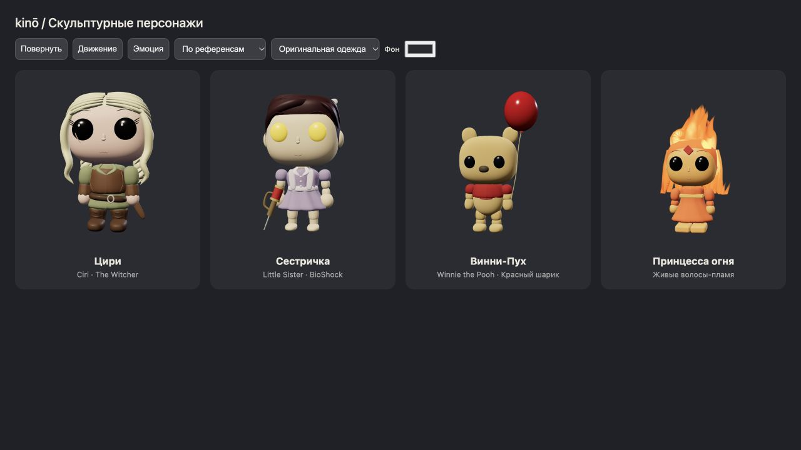
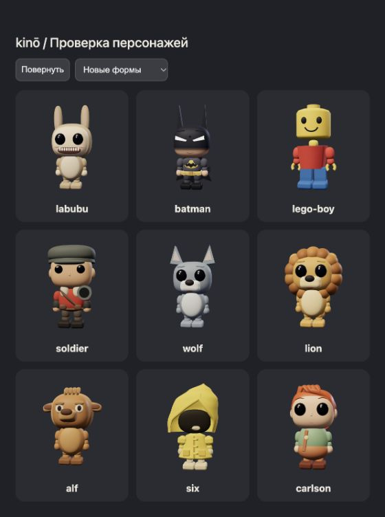
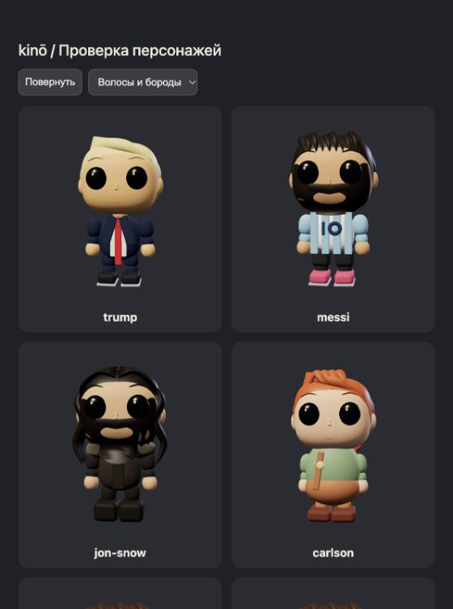
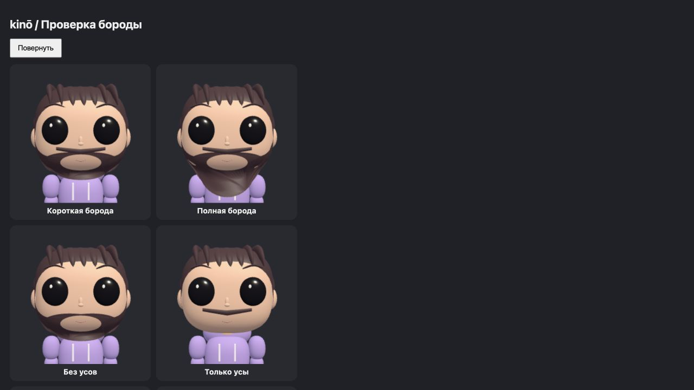
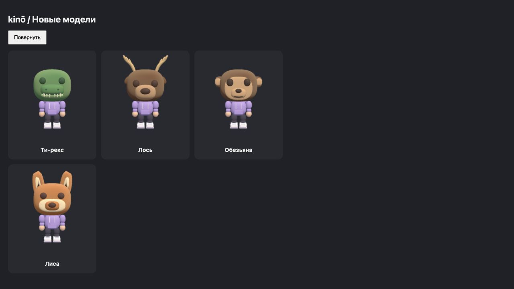
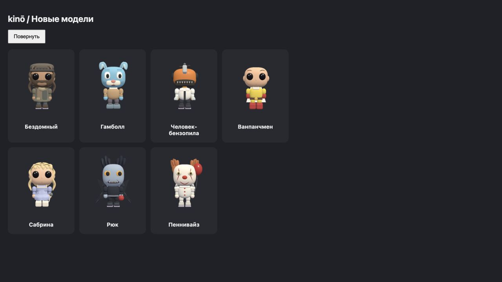

# Модели персонажей и сменная одежда



Рендер моделей в проверочной сцене с нейтральным освещением.











## Что работает сейчас

Модели строятся в Three.js из процедурных поверхностей. `avatars.js` создаёт общие суставы и базовый гардероб, `characters.js` меняет лицо и добавляет детали конкретного персонажа. `sculpt.js` содержит сглаженные формы головы и тела, поверхность причёски, непрерывные пряди и одежду по профилю. Небольшие детали используют менее плотную сетку; общие геометрии и материалы кэшируются. `disposeAvatar` освобождает только ресурсы конкретного экземпляра.

Силуэт, пропорции, причёска и характерные предметы важнее количества полигонов. Четыре варианта бороды и усов настраиваются независимо от причёски. Борода лежит на поверхности лица как одна сетка с отверстием для рта; у полной бороды длиннее линия подбородка. В редактор добавлены боковой пробор, зачёс, короткая текстурная укладка и длинные волны. Цири получила светлые косы, жилет и сапоги, Сестричка — лавандовое платье, банты, жёлтые глаза и шприц, Винни — золотистый окрас, короткую красную футболку и шарик. Капюшон Шесть построен из изогнутых колец вокруг теневого проёма. У LEGO boy скруглены грани головы, у Лабубу заменены отдельные выступы, у Бэтмена подбородок встроен в поверхность маски. Альф получил вытянутую морду и широкие уши, Солдат — красную куртку, стальной шлем и ракетомёт в духе Team Fortress 2, а у волка и льва хвосты построены как непрерывная сужающаяся поверхность. Роботы и Спанч Боб сохраняют характерные угловатые формы. Общие человеческие головы и конечности сглажены.

Это стилизованные процедурные модели, а не точные скульптуры с фотографий. Пряди, швы и складки пока состоят из отдельных поверхностей. Для тонкой анатомии, естественных сгибов, фактуры шерсти и точного сходства нужен следующий этап — модели, подготовленные художником.

Огненная причёска объединяет непрозрачную основу и анимированные языки пламени. В `fire.js` параметры `uSpeed`, `uWind`, `uIntensity`, `uCore`, `uMid`, `uEdge` управляют движением и цветом; трёхмерный шум движется вверх. Кончики и края полупрозрачны. Это поверхностный эффект без объёмного ray marching и без отдельного bloom-прохода.

## Как добавлять детали в существующую систему

- Родитель для шапки и волос — `head`, для одежды — `torso`, для предмета в руке — соответствующий `elbow`, для обуви — `foot`/`knee`. Геометрию создаём в локальных координатах сустава.
- Деталь регистрируется в `rig.features` с устойчивым именем. Проверяем `signatureHead`, `signatureBody`, `signatureFeet`, чтобы смена гардероба удаляла оригинальный предмет.
- Одежда скрывает закрытые ею базовые меши. Скрытие не должно отключать дочерние суставы; для этого используется `hideMeshes`.
- Вторичное движение регистрируется отдельно в `rig.secondary`. Анимация не должна сбрасывать индивидуальные размеры кистей, лица и других деталей.
- Уникальную геометрию освобождаем вместе с аватаром; кэшируемую геометрию и материалы сохраняем для остальных участников.

## Рекомендуемый следующий этап: Blender → GLB

Начать с одного эталонного человеческого тела и одного скелета. Настроить пропорции по трём видам — спереди, сбоку и сзади — и сначала проверить модель без волос и одежды. Сохранить эталонную позу и названия костей. Модели с радикально другой анатомией (Винни, Альф, Спанч Боб) удобнее делать отдельными семействами с совместимым набором действий.

| Элемент | Подготовка | Подключение в приложении |
| --- | --- | --- |
| Тело и лицо | Один базовый mesh, чистая топология, небольшой набор morph targets | Ограниченные параметры пропорций |
| Рубашка, платье, брюки | Отдельные меши с весами того же скелета и той же bind pose | Замена mesh в слоте одежды |
| Волосы, шапка, очки | Отдельные объекты с одинаковой точкой привязки | Узел на голове |
| Меч, шарик, шприц | Отдельные объекты с понятным origin | Узлы `hand.L`, `hand.R`, `back`, `hip` |
| Кожа, волосы, ткань, кожа одежды, металл | Стабильные имена material slots | Палитра меняет tint нужного материала |
| Мелкие складки и шерсть | Запечённые normal/AO/roughness карты | Детализация без сотен отдельных мешей |

Для одежды добавить маски скрытия частей тела: например, сапоги скрывают стопы и голени, закрытая рубашка — торс. Это проще и надёжнее, чем постоянно увеличивать одежду до исчезновения пересечений. Для разных тел у предмета должны быть совместимые варианты; произвольное масштабирование одежды не заменяет подгонку и веса.

Передавать по сети только версионированную конфигурацию, а GLB загружать и кэшировать на клиенте. Пример будущего формата (сейчас не реализован):

```json
{
  "version": 1,
  "body": "human-v1",
  "face": "ciri",
  "hair": "ciri-braids",
  "slots": {
    "top": "leather-vest",
    "bottom": "olive-trousers",
    "feet": "witcher-boots",
    "hip": "sword"
  },
  "colors": { "hair": "#e6dfad", "cloth": "#87916a" }
}
```

GLB можно загрузить через [GLTFLoader](https://threejs.org/docs/pages/GLTFLoader.html). Одежда с деформацией использует [SkinnedMesh](https://threejs.org/docs/pages/SkinnedMesh.html); для независимых экземпляров персонажей со скелетами подходит [SkeletonUtils.clone](https://threejs.org/docs/pages/module-SkeletonUtils.html). При перекраске клонировать изменяемые материалы экземпляра, иначе цвет изменится у всех, кто использует общий материал.

Сначала сделать один комплект Цири: тело, причёска, жилет, сапоги и меч. Проверить ходьбу, приседание, поднятые руки, бросок и все эмоции. Затем перенести остальные образы на проверенные правила. Плотность сетки, размеры текстур и количество материалов выбирать после замеров сцены с 16 участниками на слабом устройстве; для миниатюр и дальних аватаров подготовить облегчённые варианты. Сглаженные нормали и качественный силуэт полезнее безусловного subdivision всей модели.

## Проверка

`npm run check` проверяет сохранение идентичности, замену одежды, анимации, кадрирование и освобождение ресурсов. `tests/sculpt.test.mjs` отдельно проверяет направление нормалей, отсутствие нечисловых вершин, сохранность общей геометрии и пропорции кистей после анимации. Эти тесты не оценивают художественное сходство: его нужно смотреть в WebGL спереди, сбоку, сзади, в движении и при смене одежды.
